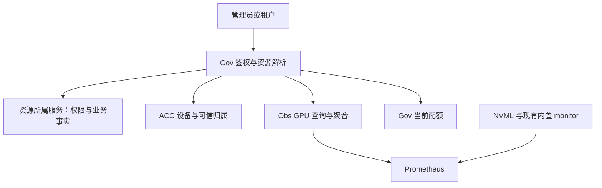

# GPU 监控后端一期实施方案 v1.1

日期：2026-10-27（Asia/Shanghai）。状态：依据多轮讨论修订，待实施；本次仅更新和复核方案，未执行代码修改、构建、数据库迁移或集群部署。

本版替代原《GPU 监控后端一期实施计划》中与本版不一致的功能、身份关联、采集和验收条款。此前隔离工作树中的未编译草稿保持冻结，不能视为本版实现或可运行交付。

## 0. 本版确定的决策

| 编号 | 确定决策 | 对实施的约束 |
|---|---|---|
| D01 | 一期支持近 30 天查询 | 默认 24 小时；预设 1h、6h、24h、7d、30d；支持最近 30 天内自定义区间 |
| D02 | 统一使用平台业务资源身份 | 公开请求使用 `resource_kind + resource_id`；内部复用 ACC `UsageRef`，不为每类业务另造归属主键 |
| D03 | 一期资源明细实际接入容器实例和推理服务 | 租户汇总按统一可信归属聚合；训练、微调明细按 ModelDev execution 扩展，不自动增加本期全链路联调 |
| D04 | 继续使用现有内置 HAMi monitor | 优先补齐现有 `volcano-device-plugin` Pod 内 monitor 的抓取；不默认新增独立完整 monitor |
| D05 | 不强制修改上游或给原始指标补 Pod UID | 已由用户在环境确认指标不带业务 Pod UID；通过平台可信映射归属到业务资源 |
| D06 | 30 天所需历史业务归属是必交项 | 优先复用 ACC 记录并补齐历史保留；不强制新建独立历史表，不要求完整分配事件史 |
| D07 | 共享 SM、租户计算利用率移出一期 | 保留物理整卡利用率、共享实际显存和运行时显存限额；不修改 HAMi 限额与反馈机制 |
| D08 | 后置分配积分等历史功能 | GPU·小时、GiB·小时、完整租户历史分配曲线、历史配额、独立的已删除资源查询均不交付 |
| D09 | GPU 查询采用适合多来源的模型 | 可复用或扩展 Obs；不能靠放宽既有 CPU/内存/训练单来源规则实现 |
| D10 | 保持已有生命周期与配额写入规则 | 本期只增加监控读取及必要归属保留；不增加创建、调度、释放、退额或 Start/Stop 占退额逻辑 |
| D11 | 存储扩容和保留配置由其他任务负责 | 本批不修改 PVC、文件系统、retention、retentionSize 或卷模板 |

## 1. 目标、范围与业务主链

### 1.1 一期功能

| 能力 | 本期交付内容 | 权限与范围 |
|---|---|---|
| 平台 GPU 总览 | 已登记物理设备及观测新鲜度、当前可信分配与可分配容量、物理实际负载与趋势 | 平台管理员；按集群、型号等受控维度筛选 |
| 物理卡监控 | 利用率、实际/总显存、温度、瞬时功率的最新值和历史；受支持的错误指标及采集状态 | 平台管理员 |
| 各租户用量 | 当前可信分配、实际显存最新值、历史曲线、区间均值与峰值、当前配额摘要 | 平台管理员；按租户聚合，不增加管理员容器明细浏览功能 |
| 本租户用量 | 自身汇总，以及已授权业务资源的 GPU 实际显存和运行时显存限额 | 当前租户；首批资源为容器实例、推理服务 |
| 当前配额 | 当前限额、权威占用、余额、超额、是否配置及实际执行能力 | 管理员按租户分页；租户只能读取自身 |

“物理设备数量”明确指 ACC 已登记范围内的设备，不承诺代表 Kubernetes 集群中所有未纳管 GPU。设备清单同时返回观测时间及新鲜/陈旧状态；不能把持久化的离线设备行直接计入“当前健康设备数”。[S01]

默认时间窗口为 24 小时；支持 1h、6h、24h、7d、30d 及最近 30 天内的自定义区间。30 天适用于物理卡指标、授权资源的实际显存/运行时限额，以及租户实际显存统计。Xid 等事件型指标按第 4.4 节的专门语义返回。

资源明细入口的类型启用列表与租户汇总范围分开。租户汇总读取查询区间内该租户的可信 UsageRef 集合；其他 owner（例如已有 ModelDev 执行）若已满足相同归属、运行范围和 HAMi 来源合同，可由通用聚合计入。未覆盖的类型或未知范围必须返回覆盖说明，必要时标为 PARTIAL；不能静默排除后声称完整租户总量。该行为不等于本期交付 ModelDev 明细 API、执行发现适配或训练/微调实时联调。

### 1.2 本期之外

以下能力不进入一期任务和完成门槛：共享 SM/租户计算利用率、GPU·小时及 GiB·小时分配积分、完整租户历史分配曲线、历史配额、独立的已删除资源列表/详情/曲线入口、告警、计费、前端和 installer 接入、训练/微调实际 GPU 监控联调、动态整卡/共享切换。

**已删除资源的明细入口后置，不影响其可信历史样本计入原租户的 30 天汇总。** 租户历史汇总不能只枚举当前还存在的业务资源。

平台设备分配历史若已有 scheduler 数据可保留为独立的管理员观测来源，但本期不新增其趋势交付门槛，也不能用它代替租户可信归属、实际显存或分配积分。

### 1.3 请求与数据流



资源所属服务为 Res、Inference，以及后续接入的 ModelDev 等。Gov 通过各服务现有可信接口/持久化事实解析资源；Obs 不直接解析业务权限、不直接查询 Kubernetes 或 Gov 配额数据库。

第一条真实主链仍是管理员通过 Gov → Obs → Prometheus 取得物理卡最新值和历史。之后接通真实租户容器、推理类型适配、共享显存与租户汇总。Prometheus 可查询、exporter 健康或单独一个服务接口可用，都不能替代整条主链验收。

## 2. 项目职责与实施边界

| 项目 | 本期职责 |
|---|---|
| ani-observability-service | GPU 指标目录、来源模型、最新值/范围查询、去重与聚合、质量/覆盖信息、独立查询预算、采集清单 |
| ani-governance | 对外 API 与权限、受控资源类型解析、可信 scope 编排、平台/租户访问隔离、当前配额批量读取 |
| ani-accelerator-service | 设备身份、可信当前绑定、监控专用范围读取、30 天所需历史已核验归属保留、当前分配/容量事实 |
| ani-resource-service / ani-inference-service | 优先复用已有业务身份、授权和运行映射；仅当存在明确读取缺口时做最小适配 |
| ani-modeldev-service | 本期核对执行身份合同和扩展方式；不要求新增实际监控部署或训练/微调运行验收 |

Res/Inference 的适配不得顺带重构创建、停止、启动、删除或调度链路。业务实例 ID、推理服务 ID 的生命周期沿用所属服务定义。

Gov 继续拥有配额和 usage 同步；ACC 继续拥有设备、绑定与容量；业务 owner 继续拥有资源生命周期。实例退出、Pod 重建、监控断报或 Usage ENDED，都不由监控代码解释为释放或退款证明。

ani-boss-console、ani-console、ani-installer、ani-node-agent 不作为本批默认修改项目。部署清单手动接入，installer 集成另开任务。其他任务中的存储修改不因本方案获得额外授权。

## 3. 通用业务身份与未来类型接入

### 3.1 两层身份

公开 GPU 资源查询使用受控的 `resource_kind + resource_id`。租户来自认证上下文；调用方不能自报 owner、创建操作、namespace、Pod、设备标签或 PromQL 来扩大范围。

Gov 将请求解析成 ACC 已有的可信引用：[S02]

```text
UsageRef {
  tenant_id
  owner_service
  resource_id
  create_operation_id
}
```

`create_operation_id` 标识原始业务创建生命周期，必须来自可信账本/owner 事实，不能填本次查询请求 ID，也不能因普通 Stop/Start 或 Pod 替换而重建。相同文本 resource ID 若对应不同创建生命周期，不能未经区分合并。

`resource_kind` 是接入路由和业务分类；不能仅凭 owner 推断具体资源类型。Gov 现有合同已经允许同一个 owner 管理不同资源种类。[S03]

### 3.2 资源映射

| 业务对象 | Gov 资源种类 | 归属 owner | `resource_id` | 本期状态 |
|---|---|---|---|---|
| GPU 容器实例 | `container` | `ani-resource-service` | 容器实例 ID | 实际接入 |
| 推理服务 | `inference` | `ani-inference` | 推理服务 ID | 实际接入；不要求新建真实推理实例 |
| 训练执行 | `modeldev` | `ani-modeldev-service` | `execution_id` | 扩展合同 |
| 微调执行 | `modeldev` | `ani-modeldev-service` | `execution_id` | 扩展合同 |

以上 owner 为当前协议身份，不能用仓库名自行替换。ModelDev 已以 `GENERAL_TRAINING` / `FINETUNING` 区分业务意图；Gov 的 ModelDev GPU 合同明确校验 `ResourceID == ExecutionID`。[S04]

训练/微调以一次 execution 为监控基本单位；任务模板、模型、产物和工作流分组 ID 不替代 execution 身份。同一任务的不同 execution 分别查询；同一 execution 的多个 worker/Pod 通过运行范围集合表达。重试是否生成新 execution 沿用 owner 定义。任务级跨 execution 汇总留待相应产品功能接入。

### 3.3 最小扩展机制

Gov 的资源明细入口使用明确的类型分发表或静态适配器：每种已启用资源类型负责读取权限校验、业务 ID 解析、原始 UsageRef 校验。未知或尚未启用的明细类型返回明确错误，不把任意 owner 字符串当作扩展机制。租户汇总遵循第 1.1 节的通用归属范围，不因明细入口尚未启用就丢弃已经满足合同的可信样本。

ACC 继续使用 owner 白名单、签名及 Pod 身份核验。取消原始 GPU 指标必须包含 Pod UID 的要求，**不等于删除 ACC 内部的 Pod UID 或放宽所有权校验**。[S05]

Obs 使用“业务资源引用 + 一对多运行范围”的 GPU 模型。相同来源和指标语义下，新业务类型复用指标查询与聚合；确需新增指标语义时，在目录和来源适配处显式扩展。无需建立动态插件框架、训练专用 GPU 归属表或每类业务一套采集器。

现有 Gov `usageRef` 读入口仍有限定 InstanceOwner 的分支；Obs 既有 `TRAINING_EXECUTION` 查询也有具体 Pod UID 约束。它们是实施时需要适配的现状，不能据此声称通用 GPU 查询已经实现，更不能全局放宽旧校验。[S06]

## 4. 指标、采集与设备关联

### 4.1 三类数值分开返回

| 口径 | 含义 | 权威来源 |
|---|---|---|
| 配额占用 | 业务受理占用的额度；可能尚未调度 | Gov 配额账户 |
| 当前分配 | 已观测的整卡绑定、共享显存分配等 | ACC 当前可信绑定及容量事实 |
| 实际负载 | 物理 GPU 活动、实际显存、温度和功率 | NVML / HAMi 指标 |

物理卡按设备身份去重；不把逻辑 vGPU 数量当作物理卡数量。整卡数量、共享显存 MiB、实际显存 bytes 分字段表达。ACC 已归一为 MiB 的分配值不再次乘 memory factor；确需处理原始调度单位时，使用该条事实的换算依据，不能将当前 factor=10 写成全局或历史常量。[S07]

当前分配和可分配容量随观测完整度返回；失联、陈旧或冲突不能一概计为已释放。可分配容量和配额余额都不是创建成功保证。Gov/ACC/Obs 分别返回各自观测时间，不声称跨服务读取处在同一数据库快照。

### 4.2 采集器分工及部署要求

| 来源 | 本期用途 | 实施约束 |
|---|---|---|
| nvidia_gpu_exporter v1.16.0 NVML | 物理显存、利用率、温度、瞬时功率、采集健康、受支持的错误指标 | 固定镜像 digest/源码版本；内网分发后覆盖本期纳管 GPU 节点 |
| `volcano-device-plugin` Pod 内现有 monitor | 容器实际显存与运行时显存限额 | 核对实际镜像、缓存路径、端口和抓取配置，优先复用 |
| 已有 Volcano scheduler exporter | 现有管理员设备分配观测 | 不作为实际负载，不负责本期租户历史归属 |

物理同项指标以 NVML 为本方案统一来源；现有 HAMi Host 指标不与其相加。一个节点的 HAMi 指标选择一个受控采集入口；重复 job/endpoint 不得重复计量。

采集 profile 一次性登记可信 `cluster_id`、采集节点身份、来源及实际抓取周期。建议 NVML 15 秒、HAMi 30 秒；如当前部署不同，以核实后登记的周期为准，并同步新鲜度和统计参数。cluster、node 等标签来自受控采集配置/发现信息，不接受 exporter 或公开请求冒充另一集群的身份。

原稿中 host `/usr/local/vgpu/vgpu` → monitor `/tmp/vgpu` 是临时验证记录；它不能直接证明现有内置 monitor 的挂载相同。实施时核对实际生效路径，只有发现缺口才修改。

现有 monitor 包含缓存反馈写入和过期目录清理，不能按纯只读 exporter 描述。本期保留既有反馈职责，不额外启动一个完整 monitor 竞争同一缓存。移除 SM 监控项不改变运行时 SM/显存限额或控制反馈。[S08]

仅补抓取对象且不改 Pod 模板时，不需要为此替换插件 Pod；若确需修改同一 DaemonSet 的镜像、挂载、环境变量或模板，其更新可能重建整个 Pod，必须写清实际影响和执行窗口，不能承诺主 device-plugin 容器绝不重启。[S09]

NVML 部署优先复用原稿已验证的非 root NVIDIA runtime 配置；不占用业务 GPU 配额，不新增对外 NodePort。该配置需在目标节点复核，不把单节点临时验证视为全节点常驻部署完成。

### 4.3 一期标准指标

下表业务编码为本方案的 GPU 目录编码；原始指标名与业务编码分别管理。所有选择器由 Obs 构造。

| 业务编码 | 原始指标 | 单位/类型 | 查询对象 |
|---|---|---|---|
| `gpu.physical.utilization_ratio` | `nvidia_smi_utilization_gpu_ratio` | ratio，gauge，0～1 | 物理卡/同型号物理分组 |
| `gpu.physical.memory_used_bytes` | `nvidia_smi_memory_used_bytes` | bytes，gauge | 物理卡/物理显存汇总 |
| `gpu.physical.memory_total_bytes` | `nvidia_smi_memory_total_bytes` | bytes，gauge | 物理卡/物理显存汇总 |
| `gpu.physical.temperature_celsius` | `nvidia_smi_temperature_gpu` | °C，gauge | 物理卡 |
| `gpu.physical.power_instant_watts` | `nvidia_smi_power_draw_instant_watts` | W，gauge | 物理卡 |
| `gpu.resource.memory_used_bytes` | `vGPU_device_memory_usage_in_bytes` | bytes，gauge | 授权资源/租户汇总 |
| `gpu.resource.memory_limit_bytes` | `vGPU_device_memory_limit_in_bytes` | bytes，gauge | 授权资源的运行时限额 |

HAMi 两项显存 gauge 的原始业务标签为 `podnamespace`、`podname`、`ctrname`、`vdeviceid`、`deviceuuid`。用户确认当前指标不带业务 Pod UID；所核对上游输出也不含平台资源 ID，本方案按未做可信业务标签富化设计。上游内部按 UID 匹配缓存不等于输出指标带 UID。[S10]

实际显存和运行时限额都不得使用 `rate()` / `increase()`。不使用误标 Counter 的 `Device_memory_desc_of_container` 表示当前显存。不用平均功率冒充瞬时功率，不用 HAMi Host 指标在失败时的初始化零值补 NVML 缺失。

物理整卡利用率只在物理维度返回；即使一个租户占用了共享卡，也不能把整卡利用率复制成该租户利用率。一期目录不登记 `Device_utilization_desc_of_container` 对应的共享 SM 或租户计算指标。

### 4.4 错误指标

| 项目 | 返回语义 |
|---|---|
| ECC 可纠正/不可纠正计数 | 型号与采集能力支持时返回；明确不支持与暂时采集失败分开 |
| 重映射行计数/状态 | 返回 correctable、uncorrectable、pending、failure 的真实值；有效零值保留 |
| `nvidia_smi_xid_errors_total{uuid,xid}` | 当前 exporter 进程启动后观察到的累计事件数，保留重启边界 |
| `nvidia_smi_xid_last_timestamp_seconds{uuid,xid}` | exporter 接收到最近事件的时间，不是硬件原始发生时间 |

错误数据只走 exporter → Prometheus → Obs，不增加系统日志解析。Xid 首次事件才产生序列，不能回放 exporter 启动前的事件；`increase()` 可能漏掉首次事件，无序列不等于历史零错误。不能把该 counter 宣称为最近 30 天准确累计错误数，也不对它套用普通 gauge 的桶均值。[S11]

普通 NVML 采集状态与 Xid 事件监听状态分别表达。全局采集成功不能证明所有可选字段受支持；普通采集失败也不自动否定仍有效的 Xid 事件序列。

原稿 node1 两张 4090 的 ECC 不支持、重映射有效零和监听注册成功，仅作为当时环境记录。不在业务环境制造 GPU 故障；通过真实格式边界用例验证适配时，明确标为适配验证，不冒充真实故障事件验收。

### 4.5 设备身份归一

NVML 的 UUID 标签为小写且不带 `GPU-` 前缀；HAMi/ACC vendor UUID 可带该前缀。增加统一的 vendor UUID 归一函数用于指标关联，保留原值便于审查，并同时限定集群和可信节点身份。[S12]

ACC 现有 DeviceID 生成算法保持不变。节点重建或设备迁移后的设备记录按 ACC 身份处理，不能仅凭相同裸 UUID 将不同节点历史任意拼接。物理索引、`job`、`instance`、endpoint 均不作为业务资源身份。

ServiceMonitor 发现的 exporter Pod UID 是采集器自身的身份，不能重命名为业务 Pod UID。KSM 当前 UID 可以提供运行旁证，但不能单独证明某条 HAMi 样本来自哪一代业务 Pod。

## 5. 可信归属和 30 天历史

### 5.1 必交能力与最小实现

一期必须交付支持 30 天资源/租户实际显存查询的可信归属索引，覆盖启用后可证明的 Pod 替换、节点变化和资源释放。它只保存监控所需的业务关联及证据范围，不承担完整分配事件流、分配积分或逐代运行审计。

按以下顺序实现：

1. 复用 ACC 现有绑定记录及可信 owner 事实。现有绑定键是 `(cluster_id, pod_uid, container_name, device_id)`；新 Pod UID 已产生独立行。[S13]
2. 确保此前已核验的 UsageRef、运行选择范围和依据不会被后续当前状态覆盖掉。现有 upsert 会覆盖归属列及 payload，`VerifiedUsageRef == nil` 时可写入空归属；因此仅保留旧行不够。[S13]
3. 现有结构能表达时补齐历史保留字段/投影；不能表达时增加最小归属历史记录。只记录身份、证据或适用范围变化，不要求每次 scrape 写一条 SQL 事件。
4. 当前归属未知/冲突与过去已核验归属分开。不能为了保留历史，把旧 owner 永久当作当前有效 owner。
5. 索引保留仍有效的长期关联，以及近 30 天查询需要的退役关联；不能仅按记录创建时间删除一个仍在使用的关联。已知跨资源复用且仍未消歧的来源键状态，按第 5.4 节保留至有可信消歧证据，不能因历史超龄自动清除。新增持久化通过显式迁移，不在服务启动时自动迁移。

历史归属能否满足本节必须有验收结果，不能继续写成“实施时再核实是否需要补”。允许选择现有记录扩充或最小投影，是实现选择；历史能力本身不是可选项。

### 5.2 内部监控范围合同

ACC 增加 Gov 专用、逻辑上区分管理员与租户的监控范围读取能力，例如 `ListAdminGpuMetricScopes` / `ListTenantGpuMetricScopes`。正式 protobuf 方法名和 HTTP 路由在第 9 节阶段 0 按仓库规范冻结；以下字段与语义固定。

| 信息组 | 必需内容 |
|---|---|
| 业务引用 | 已核验 UsageRef、受控资源种类/必要业务分类 |
| 指标选择范围 | cluster、可信采集节点、namespace、Pod name、container、vendor GPU UUID；可取得的 vdevice 维度 |
| 内部运行证据 | Pod UID、节点 UID、ACC DeviceID、binding ID、核验依据；字段按实际证据完整度返回 |
| 历史适用性 | 可证明的适用范围、未知/冲突范围、索引实际可用起点、证据时间、水位及索引完整状态 |
| 分页信息 | 有界分页、稳定排序及查询水位/快照标识，防止范围分页漏项或双算 |

Pod UID 在这里属于内部证据；不要求原始 GPU 指标同时含有它。模式、当前分配量和 memory factor 仍由当前分配/容量读取提供，不为已后置的分配积分扩展历史合同。

租户方法只返回认证 TenantContext 内的归属；管理员方法要求平台权限与受信 Gov 调用。不能用假的租户 UUID 调平台查询，也不能把普通租户请求转换成管理员读取。公开租户响应不暴露 Pod、节点、物理设备和绑定标识。

**候选冲突核查先于租户/资源结果过滤。** ACC 在受控的采集核验阶段或内部索引处理中，对原始来源键检查跨租户、跨资源候选及历史完整性，再返回请求范围内的 scope 和脱敏冲突状态。若先按 tenant/resource 过滤再判断唯一，会漏掉真正冲突的其他候选。此能力不向租户返回其他租户身份，不将租户请求转换成管理员调用，也不移除既有数据隔离规则。

现有租户 `ListBindings` 已主动隐藏运行与物理字段，不能直接拿来拼完整 scope；`ListGpuUsages` 也不能单独提供设备/Pod 映射。新方法应在内部受信边界解决该缺口，保留现有公开接口的隐藏规则。[S14]

租户历史 scope 查询按该租户在请求时间内的可信记录取得，包括已删除资源和满足统一合同的其他 owner 历史；同时返回类型/来源的覆盖情况。授权资源明细查询仍先检查该类型已启用及资源当前读取权限，不顺带新增删除资源入口。

### 5.3 原始指标没有 Pod UID 时的匹配规则

匹配对象是**某个原始 GPU 样本属于哪个业务资源**。对样本的实际 Prometheus 时间及下列维度进行匹配：

```text
cluster + 可信采集节点 + namespace + Pod name + container
        + 归一后的 GPU UUID + 原始 vdevice id
```

| 候选情况 | 处理 |
|---|---|
| 只有一个可信业务引用 | 归入该资源 |
| 多个候选 Pod UID，但全部属于同一 tenant/owner/resource/create 生命周期 | 可归入同一资源，不因 UID 不同自动判歧义 |
| 一条样本匹配同资源的多条历史绑定 | 完成归属后只计一次 |
| 存在跨租户、跨资源或跨创建生命周期的候选 | 该样本不进入相关业务汇总，返回歧义/缺口 |
| 候选范围不完整、证据不足或来源冲突 | 返回未知/缺口；不按当前 owner 猜测 |

“候选一致”必须有可信归属、历史完整性或受控命名/生命周期事实支撑。数据库当前只查到一条记录，不足以证明旧缓存不可能来自其他资源。Pod 名字中的实例 ID、普通标签、当前 KSM UID 都不能单独替代所有权核验。

同一资源的 Pod 替换可以保留业务归属；实际不同的推理副本、容器、worker、GPU 则分别参与聚合。不能只按 resource ID 或物理 UUID 去重，也不能先按每条 binding 求值再相加。

本期不强制改上游 monitor、不强制增加自研 collector，也不承诺逐 Pod/容器代次的精确历史。若发现具体的跨资源归属缺口，先记录缺口、影响范围和现有可信映射能否解决；不得自行扩大为上游改造或新采集组件任务。

### 5.4 时间、缓存和真实覆盖

必须区分三个时间：

| 时间 | 含义 |
|---|---|
| `sample_time` | 原始 Prometheus 样本时间；通常是 scrape 时间，不等于 GPU 缓存内部测量或硬件事件时间 |
| `timestamp` / 桶边界 | Obs 输出的查询求值时间或展示桶时间 |
| 归属证据时间 | ACC/owner 观察、核验、退役或冲突证据的时间 |

先对原始样本取得时间信息，再做归属和有效性判断。不能把 recording rule 的写入时间或 `query_range` 返回的求值时间直接当作原始样本时间；需要原始 `timestamp(...)` 配对或保留等效时间证据。[S15]

首次/末次核验时间不自动等于精确运行开始/结束，也不能只靠两个观测点就宣布中间全部有效。仅在可信生命周期或连续有效证据支持时扩展适用范围。监控断报、当前 Pod 删除和 Usage ENDED 不自动生成精确结束时间。

业务归属与样本有效性分别判断。同一资源的旧/新 UID 归属一致，不代表旧缓存一定是有效当前测量；新鲜 scrape 也不能证明缓存属于新 Pod。已知过期、冲突或失效证据按质量规则处理；没有缓存内部时间时，明确新鲜度证明到 scrape 层，不伪称已经验证缓存实时性。数值长期不变本身也不构成过期证据。

对于**已知跨资源复用**的无 UID 原始来源键，旧资源的业务区间结束不单独证明 monitor 已停止输出旧缓存。不能只按业务时间边界切换 owner、等待固定新鲜度窗口或删除超龄历史就自动消歧；保留未消歧状态，直到取得可信的来源排他、缓存失效或等效证据。此规则不影响同一 UsageRef 下 Pod 替换的归属，也不自动增加上游/采集器改造任务。

从启用后积累可证明历史。返回指标和归属的实际可用起点及缺口；没有原始样本或可信归属的过去时间段不回填，不用当前 owner/KSM/Pod 列表追认 30 天历史。

## 6. Obs GPU 查询、聚合与预算

### 6.1 查询模型与兼容性

复用现有 Prometheus 客户端、mTLS、受信 Gov 连接和通用工具。GPU 单独定义目标范围、来源身份、聚合规则、质量原因和查询预算；可放入专用 GPU 查询服务/模块，避免改变既有 CPU、内存、网络、训练查询的返回语义。

现有 Obs 会把同一时点的多个 PodUID/ContainerID 来源判为歧义，并有 24 小时、4 秒、单次序列和响应体限制。不能原样套用后声称支持 GPU 多副本和 30 天，也不能全局调大这些限制影响旧入口。[S16]

GPU 标准来源键使用第 5.3 节运行维度；采集路径用于识别重复抓取，不加入业务归属。重复样本一致时去重，受控来源仍冲突时标记 `SOURCE_CONFLICT`，不随机选一个也不求和。唯一来源集合形成后，再按可信资源引用与租户聚合。

### 6.2 最新值与历史统计

最新值在统一 `query_time` 评价所有来源，只使用 `sample_time <= query_time` 且在新鲜度范围内的样本，并返回来源样本时间范围；不向过去无限寻找最近非空值。历史实际显存统计采用固定 30 秒基础格；物理指标可按 15 秒基础格处理，必须返回各指标的实际基础分辨率。这里的均值/峰值均指基础格观测结果，不承诺连续时间真值。

每个基础时点依次执行：来源验证与去重 → 原始样本时间和归属核验 → 新鲜度/质量判断 → 同资源求和 → 同租户求和。统计区间的均值、峰值再从这些同时点总值计算。

**不得把各资源在不同时刻出现的峰值相加作为租户峰值。** 不得用物理显存总量替代业务实际显存，不得将运行时限额当成实际用量或 Gov 配额。

同型号物理利用率分组返回均值和有效/预期设备数；不把不同型号的利用率直接加成一个值。显存 bytes 可以提供可加总的总量，同时支持型号/模式分组；组归属缺失时保留未知组或说明缺口，不能套用当前型号/模式倒推历史。

平台物理显存与已归属业务显存可能有系统开销、未归属来源或不同采样时刻等差额。两者分别返回；没有同步和来源完整证明时，不把相减结果命名为精确“其他租户用量”，不把差额分摊给租户。

### 6.3 长周期曲线与摘要

| 查询跨度 | 默认展示桶宽度 | 最大长度时约有桶数 |
|---|---:|---:|
| 不超过 24 小时（含 1h、6h、24h） | 30 秒 | 2880 |
| 超过 24 小时且不超过 7 天 | 5 分钟 | 2016 |
| 超过 7 天且不超过 30 天 | 15 分钟 | 2880 |

公开查询区间统一按 `[start, end)` 表达；内部若使用包含 end 的查询接口，须消除相邻分块边界的重复点。自定义区间由服务端确定桶宽，返回 `effective_step_seconds` 和 `base_resolution_seconds`。

基础格按 UTC Unix epoch 对齐到基础分辨率，只取 `start <= t < end` 的格点。展示桶从请求 start 按桶宽分割，末桶截到 end；每个基础格只进入一个桶，内部分块和展示桶宽都不能改变基础格集合。桶的 expected_points 按实际落入的格点数计算；极短区间没有格点时返回 NO_DATA、coverage=null，不做除零计算。

一期历史 gauge 曲线每桶 `value` 定义为**来源完整且有效的基础格**的均值，`peak` 为这些格的峰值，同时返回 complete_points、expected_points 与质量。`latest` 值独立返回，不能把桶均值标成瞬时最新值。区间均值按完整有效基础格数加权，不能直接对不同覆盖度的桶均值再取平均。部分来源的已知合计使用第 7.2 节单独定义的 known_value/known_peak。

展示桶变宽，不改变基础统计分辨率或区间峰值计算。30 秒高峰即使落在两个 15 分钟显示边界之间，也必须进入对应桶峰值和区间峰值。Prometheus `query_range` 的 step 仅是求值间隔，不自动实现桶平均或桶峰值。[S15]

实现可以分块读取并聚合，或使用保留可信身份、原始时间和质量信息的规范化结果；本版不强制新建 recording 系统。无论实现方式，必须满足相同统计语义，不得仅用稀疏展示点计算长周期摘要。

### 6.4 独立 GPU 查询预算

以下为本期独立 GPU 入口的初始上限，配置与验证归 Obs 管理，不修改旧 CPU/训练入口默认值。各上限同时生效，不承诺把所有维度同时拉到最大仍然可查询。

| 项目 | 本期上限/行为 |
|---|---|
| 时间范围 | 最近 30 天，单次跨度不超过 30 天 |
| 指标数 | 每请求最多 4 个；完整物理指标可分请求 |
| 返回曲线 | 每请求最多 12 条，每条最多 3000 个桶，总桶数不超过 12000 |
| 参与匹配的独立运行来源 | 每请求最多 128 个；多 binding 指向同一来源不重复消耗来源数 |
| 内部处理样本值 | 每请求最多 1200 万个，包括用于时间/质量判断的配对数据；可按上界估算并在执行中计数 |
| 内部分块 | 默认按不超过 6 小时时间块执行；边界去重；允许在相同总预算内调整 |
| 资源限制 | 每请求最多 4 个 Prometheus 子请求并发；全 GPU 入口最多 16 个在执行子请求；每租户最多 2 个活动 GPU 查询 |
| 时间预算 | 每个 Prometheus 子请求不超过 10 秒；Obs GPU 批次总 deadline 30 秒；遵守调用方更短 deadline |
| 数据体积 | 单次上游响应不超过 16 MiB；最终响应不超过 8 MiB；需要分块，不能依赖无限响应 |
| 超限/超时 | 返回明确错误及可缩小的时间/对象/指标维度；不截断尾部，不漏掉部分租户后冒充正常 PARTIAL |

Gov 的 GPU 路由和内部 RPC deadline 应覆盖上述有效批次预算及少量编排开销，不能仍使用旧入口的短超时把所有长查询提前切断。分页水位、scope 总量和样本预算必须计入同一个请求预算，不能通过内部分页绕过上限。

这些数值作为实施起点，阶段 0 登记，阶段 5 在本期节点规模和 30 天边界数据下验证。若不能满足，先优化分块/聚合或明确调整 GPU 专用预算并同步合同和验收，不静默降低统计精度、不改回 24 小时，也不把限流当数据缺失。

管理员租户列表分页返回当前用量和当前配额；某租户的历史曲线/摘要按指定租户另行查询。避免在列表每一行自动展开整套 30 天曲线。

## 7. 数据质量和响应合同

### 7.1 GPU 响应至少包含

| 字段组 | 内容 |
|---|---|
| 查询描述 | 业务目标、指标编码/单位、请求区间、实际桶宽和基础分辨率、聚合方式 |
| 数值 | 可空最新值、来源样本时间范围；历史桶 value/peak；部分来源的 known_value/known_peak；区间均值/峰值 |
| 状态 | `OK` / `PARTIAL` / `NO_DATA`，具体原因；可选指标能力状态 |
| 覆盖 | complete_points、observed_points、expected_points、完整格覆盖率；完整/部分/空格数 |
| 时间证据 | 指标与归属实际可用起点、原始样本时间或聚合来源时间范围、数据截止时间 |
| 不完整信息 | 缺口范围及原因、范围索引完整状态、纳入及未覆盖的资源类型、观测到/预期来源数（未知时显式未知） |

租户响应中的目标为业务资源/租户身份；内部 Pod、节点和物理设备来源键由 Gov 过滤。管理员设备响应可包含受权限保护的设备身份。

新增 GPU 缺失原因在 GPU DTO/映射中登记，不能直接塞进既有 CPU 接口的严格枚举映射。公开错误码、gRPC/HTTP 对应关系在阶段 0 一起冻结。

### 7.2 质量判定

1. 有效零值返回零；缺失为 null，不用零、NaN 或无穷值填补。只有可信事实证明整个聚合范围确实为空时，才允许给出有依据的零；“没有抓到序列”不是该证明。
2. 原始非有限值、无法解析的单位/身份、重复来源冲突不进入聚合。按指标登记值域：显存、功率、计数须非负，物理利用率在 0～1；温度等不能套统一非负规则。异常值标 `INVALID_VALUE`，不截断成零。其余至少区分 `STALE_SAMPLE`、`SCRAPE_UNAVAILABLE`、`OWNERSHIP_UNKNOWN`、`OWNERSHIP_AMBIGUOUS`、`SOURCE_CONFLICT`、`HISTORY_UNAVAILABLE` 等原因。
3. HTTP `up`、NVML 普通采集、事件监听、可选指标能力分别表达。只有明确能力检测或设备响应证明不支持时标为不支持；仅无指标时保持未知。
4. 缺初始化缓存时按无数据返回；未取得明确初始化证据，不自行断言业务“未初始化 CUDA”。
5. 新鲜度使用原始样本时间，在基础时点 t 要求 `0 <= t-sample_time <= 3×抓取周期`：NVML 15 秒对应 45 秒，HAMi 30 秒对应 90 秒；作为 profile 参数记录并验证。此阈值不证明 informer/缓存已切换到新 Pod，也不作为跨资源替换边界的固定等待保证。
6. 一个基础格内只有部分应有来源有效时，可以返回已知合计，但标为 PARTIAL；预期来源集合本身未知时，不能声称完整。归属不明样本不进入任何租户的已知合计。
7. 区间摘要只基于来源完整且有效的基础格计算；若整个窗口没有完整基础格，摘要均值/峰值为 null，仍可返回 PARTIAL 的已知部分曲线。缺失不进入摘要分母，已有摘要也必须带覆盖率，不能称为整个窗口的完整均值/真实峰值。
8. `coverage = complete_points / expected_points` 表达完整采样格覆盖率；`observed_points` 为至少有一个有效来源或有证据的零的基础格数，包含完整格与部分格。另返部分/空格数；expected_points 为零时 coverage=null。不把该比值描述为未经证明的精确运行时长覆盖率。
9. 可信证据已确定在 t 不适用/失效的来源既不列入 t 的预期来源，也不进入 t 的数值合计，即使旧样本尚在新鲜度阈值内。停止、未运行或没有 GPU 的判断必须有可信业务/运行事实。当前分配为零不能自动证明历史无显存使用。

桶内每个有观测基础格先求可信有效来源的已知合计；`known_value/known_peak` 分别为这些合计的均值/峰值，分母使用 observed_points，包含完整格与部分格。没有完整格但有部分格时，`value/peak` 为空、known 字段可有值、状态 PARTIAL。完全无有效观测且无证明零时全部数值为空、状态 NO_DATA；所有预期格均完整时为 OK，其余有观测情形为 PARTIAL。区间完整摘要使用 complete_points；一期不再额外提供另一套区间 known 摘要。

## 8. Gov 对外能力与当前配额

### 8.1 对外边界

| 能力组 | 查询输入 | 范围限制 |
|---|---|---|
| 管理员物理/平台 GPU | 受控集群、型号、设备、指标、时间范围 | 平台权限；设备筛选由 ACC 可信身份解析 |
| 管理员租户 GPU | 租户分页/筛选；指定租户的指标与时间范围 | 平台权限；保持租户聚合粒度 |
| 当前租户 GPU 汇总 | 指标、时间范围 | 租户来自认证上下文 |
| 当前租户资源 GPU | `resource_kind`、`resource_id`、指标、时间范围 | Gov/owner 校验资源可读，再生成可信 scope |
| 当前配额批量读取 | 管理员租户分页、tenant/quota code 筛选 | Gov 直接读取本库；租户入口仅自身 |

新增路由沿用 Gov API 模块、权限登记和错误码规范；现有单租户 `/api/v1/admin/tenants/{id}/quota-accounts` 和 `/api/v1/me/quota-accounts` 保持兼容。GPU 汇总复用同一配额读取逻辑，不把 quota 放进 exporter 或 Obs。

Obs 复用 Gov mTLS 身份，但平台 GPU 与租户 GPU 的允许方法/上下文须显式登记。既有 Obs 入口要求有效租户 UUID；新增平台读取不能通过伪造租户或移除旧拦截规则实现。[S17]

### 8.2 当前配额口径

Gov 将租户、当前套餐政策、配额目录与权威账户在同一只读一致快照内批量读取。计数、租户页和关联查询必须共享快照；可使用专用只读 Repeatable Read 事务或等价单查询，不能把现有可写事务 helper 全局改成只读。

`total` 为匹配租户数，不是账户条数。不按每个租户分别查询数据库。数值继续使用现有十进制字符串表达，新增 `configured` 明确政策存在性。[S18]

| 字段 | 规则 |
|---|---|
| `configured` | 是否存在当前适用的该 quota code 政策；不能根据账户存在或 limit 非零判断 |
| `limit` | 已配置时为当前政策额度；未配置时沿用既有数值回退 `"0"`，须同时返回 `configured=false` |
| `occupied` | 权威账户占用；无账户为 `"0"`，无政策但有账户时保留真实占用 |
| `available` | 兼容既有数值口径 `max(limit-occupied,0)` |
| `overLimit` | 兼容既有数值比较 `occupied>limit`；未配置时仅表示相对回退基线的比较，不能据此宣称存在零额度政策或历史违规 |
| `enforcement` | 来自实际受控执行能力，不因目录或政策存在就宣称已实施限额 |

展示与调用方必须先读取 `configured`：未配置不表示无限额度，也不等同于明确配置零额度。`available` 只表达当前数值余额，不涵盖套餐期限、供给或其他创建校验。

| 政策/账户情况 | configured | limit | occupied | available | overLimit |
|---|---|---|---|---|---|
| 配置 0，无账户 | true | `"0"` | `"0"` | `"0"` | false |
| 配置 10，占用 12 | true | `"10"` | `"12"` | `"0"` | true |
| 未配置，无账户 | false | `"0"` | `"0"` | `"0"` | false |
| 未配置，仍占用 5 | false | `"0"` | `"5"` | `"0"` | true（结合 configured 解释） |
| 配置 10，无账户 | true | `"10"` | `"0"` | `"10"` | false |

GPU 整卡按数量、共享按申请显存 MiB 的既有计量政策保持不变。不根据 ACC 绑定反算账户 occupied，不新增第二本账，不用当前政策反推历史配额。

## 9. 实施顺序与完成条件

### 9.1 分阶段交付

| 阶段 | 交付内容 | 退出条件 |
|---|---|---|
| 0 合同与基线 | 固定目标 commit/镜像；登记 API、权限、字段和 GPU source profile；选定最小归属保留方案；冻结独立预算 | 本版 D01～D11 均有对应实现入口；既有冻结草稿重新审查后才可采用 |
| 1 管理员物理主链 | NVML 常驻采集、Obs GPU 基础查询、Gov 管理员接口 | 真实权限请求取得物理核心指标最新值和历史；来源/单位正确；无权限拒绝 |
| 2 通用资源与归属 | Gov 类型解析、ACC 监控范围与历史保留、Obs 多来源模型；接入容器/推理类型 | 真实租户容器显存/限额可查；推理适配合同和多副本聚合验证；同资源替换不串归属 |
| 3 30 天查询与汇总 | 时间匹配、长范围分块/统计、租户历史汇总、当前配额批量读取 | 30 天合法请求、真实起点/缺口、均值/峰值与配额语义正确；保留已删除资源历史贡献 |
| 4 共享显存与隔离 | 必要共享 CUDA 负载、两租户共卡、内置 monitor 配置和来源验证 | 实际显存动态变化、运行时限额、隔离/去重/缺失行为通过；不验证共享 SM 完成门槛 |
| 5 回归与交付 | 查询预算、权限、保留依赖核对、部署/回滚说明、证据归档 | 本期必交项通过，兼容性与已知未覆盖项如实记录 |

阶段 1 可单独标记“物理主链已交付”；完整一期需要阶段 2～5 的必交行为通过。不能用全部返回 PARTIAL/NO_DATA 掩盖本期范围在正常场景下长期不可用。已声明的特殊历史缺口可以如实返回，但当前正常资源、共享显存和可信历史路径必须有实际可用证明。未接入业务类型的覆盖限制单列，不借此增加训练/微调实际联调门槛；通用汇总须按第 1.1 节正确处理已有可信来源。

### 9.2 最小验收矩阵

| 编号 | 场景 | 预期 |
|---|---|---|
| A01 | 管理员物理最新/历史查询 | 经 Gov/Obs 返回真实物理核心指标；源值、单位、设备一致 |
| A02 | 普通租户调用平台接口、跨租户资源、伪造 scope | 拒绝；不能通过修改 tenant/owner/Pod 参数扩大范围 |
| A03 | 同资源 Pod A→B，UID 变化、原始指标不带 UID | 可信业务生命周期相同则可归属；不以 UID 不同自动失败 |
| A04 | 同名来源跨资源/跨租户，或候选历史不完整 | 先检查冲突再按租户过滤；不泄露其他身份；旧业务区间结束或等待固定阈值不自动消歧 |
| A05 | 旧绑定当前 VerifiedUsageRef 后来清空 | 过去已核验范围仍可查询；当前未知仍按未知处理 |
| A06 | 一条原始序列匹配同资源两条 binding | 只计一次 |
| A07 | 同资源两个真实副本共卡、多个 GPU | 独立来源均计入；不按 resource ID 或 GPU UUID 错误去重 |
| A08 | 两租户共享同一张卡 | 业务显存隔离；物理利用率不复制为租户利用率 |
| A09 | 共享 CUDA 负载开始、变化、结束 | 显存和限额来源可核验；无缓存时为空，不假造 CUDA 状态 |
| A10 | 两资源峰值出现在不同时点 | 租户峰值为同时点总和的最大值，不是单资源峰值之和 |
| A11 | 完整有效基础格上存在 30 秒高峰，位于 15 分钟显示边界之间 | 桶峰值/区间峰值保留；桶均值与瞬时值区分 |
| A12 | 相同区间不同展示桶宽 | 基础统计语义和摘要不因稀疏展示丢失高峰；均值正确加权 |
| A13 | 采集停止、旧样本 lookback、部分来源缺失 | 原始时间判断新鲜度；缺失不补零；完整覆盖与已知部分区分 |
| A14 | 查询 30 天但仅有 3 天可信样本/归属 | 请求成功或按正常数据状态返回；披露实际起点和缺口，不补造 27 天 |
| A15 | 资源已删除但历史样本与归属保留 | 租户历史贡献仍在；不新增删除资源详情入口 |
| A16 | 查询超来源/样本/响应/时间预算 | 明确超限/超时；不截断为看似正常的 PARTIAL |
| A17 | 配额配置零、未配置、超额、无账户 | 按第 8.2 节逐项一致；批量读取同快照，无逐租户 N+1 |
| A18 | 不同 UUID 大小写/前缀、节点身份变化 | 正确归一匹配；不修改 ACC DeviceID，不跨节点误合并 |
| A19 | ECC 不支持、有效零、Xid 首事件/重启边界 | 能力与缺失分开；不伪称 30 天错误总数或真实故障已观测 |
| A20 | 重复抓取或内置 monitor 配置调整 | 无重复计量；无新增完整反馈写入者；滚动影响描述准确 |
| A21 | 既有 CPU/内存/网络/训练查询 | 原权限、范围、来源校验和响应语义保持兼容 |
| A22 | 资源类型扩展合同审查 | ModelDev execution 可映射到同一 UsageRef/scope；未启用的资源明细查询明确拒绝，不宣称已交付训练/微调全链路监控 |
| A23 | 租户同时存在容器、推理和已有 ModelDev 绑定 | 资源明细启用列表不阻断通用汇总；符合合同的来源可计入，未覆盖部分披露；不增加真实训练联调 |
| A24 | 仅部分格、完全空桶、极短区间无基础格 | value/peak、known 字段、计数和状态按第 7.2 节一致；无除零、无缺失补零 |

### 9.3 环境与验证约束

本地只进行源码阅读、文档/代码轻量编辑、Git 和传输。生成、构建、数据库和行为测试在 Fedora 的任务隔离目录执行；Fedora 不可用时不擅自改成本地重任务。ACC 使用既有 `make api` / `make verify` 工作流；其他仓库执行自己的必要质量门禁。仅本次方案修订不触发这些构建和测试。

集群只使用用户指定的 10～12 集群范围，进行必要验证。租户真实主链优先用容器实例；推理适配可使用已有可信记录、现存运行对象的只读结果以及合同/边界测试，不要求为本任务新建真实推理实例。报告中分别标记代码/合同验证、真实运行读取和未进行的推理实时联调，不互相替代。

共享负载验证使用受控测试资源，不复用或破坏其他业务。测试替身只替代外部边界，关键归属、权限、聚合和持久化使用真实实现。Xid 不制造故障；真实事件输出未覆盖可保留为证据限制，不阻塞其他已满足的物理/显存功能。

### 9.4 30 天留存与完成声明

将三种状态分别记录：

1. **查询能力**：API、统计、质量和预算支持近 30 天；可以用边界数据与已有真实历史验收，不必等待 30 天积满。
2. **实际历史覆盖**：每个指标/归属的真实起点和缺口；只有积累并验证完整覆盖时，才声称已具备完整 30 天数据。
3. **生产留存条件**：其他存储任务提供目标至少 30 天的时间与容量证明；容量限制可先于时间限制删除数据，需要计入新增 GPU 指标写入量。[S19]

若生产留存条件尚未落实，可以标记“本期代码及已覆盖环境验收完成，生产 30 天留存依赖未关闭”，不能标记“完整一期生产交付完成”。本批不代替存储任务修改配置。

## 10. 核对基线、已有证据与待关闭项

### 10.1 本轮源码核对基线

这些 commit 是本次方案推导依据，不宣称部署环境正在运行相同版本。实施开始前重新比较目标分支差异，记录实际执行 SHA。

| 仓库 | 核对 commit |
|---|---|
| ani-accelerator-service | `05d7cab58a399cc89dbf369cb255281a875b3f93` |
| ani-governance | `917f623e4a0f42a7bfa30c40822b3046e9c88eea` |
| ani-observability-service | `f34282dbf9054bc37cc3ab049312b4baaa9ff52f` |
| ani-resource-service | `33ea63b4699e7d47fd0d86bef86ae8461033c869` |
| ani-inference-service | `e5e60b34e3e65f837ee2ec70c0e0d1e814ee4b47` |
| ani-modeldev-service | `1ff6982d110c2d469c34725fd32a2ade7e6488a1` |
| Project-HAMi/volcano-vgpu-device-plugin | `afefcc2ff7944e9e68275e83217cf5eb7fb4a585` |
| utkuozdemir/nvidia_gpu_exporter v1.16.0 | `104861909bb0ff46ecacf3ea9fab0f48d1903c6b` |

Gov 原稿基线为 `30a7e2d5c345ffa02a69758843cd3be7b5a726a2`，本版使用以上后续 commit 的已核对代码；不能继续将旧 SHA 写成最新核对结果。

### 10.2 环境记录的证据级别

下列实测数字来自用户提供的原稿，本轮修订未重新执行集群验证；用户另已明确确认“GPU 指标不带 Pod UID”。临时独立 monitor 的成功记录不能代替现有内置 monitor 的部署验证。

| 项目 | 原记录/用户确认 | 本期还需关闭 |
|---|---|---|
| 原物理采集 | 六卡利用率、显存和设备调度分配进入 Prometheus | 新物理统一来源及 Gov/Obs 主链 |
| NVML 临时验证 | node1 两张 4090；14 条序列各 5 次真实采样 | 镜像分发、目标节点常驻采集、接口/权限 |
| 容器显存 | 原稿记录真实 predictor 持续产生显存/限额；用户确认没有 Pod UID | 现有内置 monitor 的抓取与资源级可信关联 |
| 共享容器 | 原稿只读复核时 Pod Running、目录存在但无初始化文件、无指标 | 共享实际显存动态、运行限额、两租户共卡隔离 |
| 错误指标 | 两卡 ECC 不支持；重映射有有效零；Xid 监听注册成功 | 适配和能力表达；真实 Xid 事件未观测单列说明 |
| 归属历史 | ACC 已有可信绑定；旧 UID 独立行，但 upsert 可覆盖已核验归属 | 监控范围读接口、历史保留、30 天查询验收 |
| 配额 | 已有单租户政策/账户读取 | 同快照批量读取、configured 和兼容映射 |

原稿还记录临时验证对象已按 UID 清理、结束时 28/28 targets UP、199 个基线 Pod 的 UID/重启次数未变、node1 只保留镜像缓存且无常驻 NVML。以上仅保留为当时记录，不扩展成当前环境保证。

原证据入口（本轮未重新读取，实施时取得并归档必要部分）：

- `/home/chabking/tmp/runtime/ani-gpu-nvml-node1-probe-20261027/README.md`
- `/tmp/ani-gpu-hami-monitor-20261027/README.md`
- `/tmp/acc-current-exporter-20261027/REPORT.md`

### 10.3 本版一致性核对

| 核对点 | 本版统一口径 |
|---|---|
| 30 天是否被缩回 24 小时 | 功能、历史索引、查询预算和验收均保留 30 天；默认窗口仍为 24 小时 |
| 是否仍要求改上游/强制原始 Pod UID | 无该要求；内部 ACC UID 核验保留；跨资源不确定仍拒绝猜测 |
| 是否仍默认独立完整 monitor | 使用现有内置 monitor；避免重复反馈写入 |
| 资源类型是否写死为两类 | 统一 UsageRef 和范围集合；本期两类资源明细，通用租户汇总不静默排除其他可信来源 |
| 历史归属是否又变成可选 | 必交最小可信归属保留；不强制具体新表，不扩成完整分配历史 |
| 是否残留共享 SM 完成门槛 | 功能、目录、阶段和验收均移除；物理利用率保留 |
| 是否把后置积分/历史配额加回 | 没有；当前分配、当前配额和实际显存历史分别定义 |
| 是否把旧绑定保留等同历史完整 | 明确处理 upsert 覆盖和当前/历史状态分离 |
| 是否只用稀疏展示点算 30 天峰值 | 固定基础格先聚合再统计，展示桶另行处理 |
| 是否把支持查询等同已有完整数据 | 查询能力、实际覆盖、生产留存条件分开记录 |
| 是否把历史证据描述成本轮实测 | 原稿记录、用户确认、源码核对和未来验收明确区分 |

## 附录 A. 源码与官方文档依据

- [S01] [ACC 设备持久化/读取](https://github.com/zhangzhe-ctrl/ani-accelerator-service/blob/05d7cab58a399cc89dbf369cb255281a875b3f93/internal/data/queries/accelerator.sql)、[provider 的纳管节点和观测处理](https://github.com/zhangzhe-ctrl/ani-accelerator-service/blob/05d7cab58a399cc89dbf369cb255281a875b3f93/internal/data/provider/provider.go)。
- [S02] [ACC UsageRef、PodRef、Binding](https://github.com/zhangzhe-ctrl/ani-accelerator-service/blob/05d7cab58a399cc89dbf369cb255281a875b3f93/internal/biz/model.go#L221-L267)。
- [S03] [Gov 资源类型和 action 合同](https://github.com/zhangzhe-ctrl/ani-governance/blob/917f623e4a0f42a7bfa30c40822b3046e9c88eea/app/admin/service/internal/commandcontract/actions.go)。
- [S04] [Gov ModelDev GPU 身份校验](https://github.com/zhangzhe-ctrl/ani-governance/blob/917f623e4a0f42a7bfa30c40822b3046e9c88eea/app/admin/service/internal/commandcontract/modeldev.go#L165-L180)、[ModelDev execution 身份](https://github.com/zhangzhe-ctrl/ani-modeldev-service/blob/1ff6982d110c2d469c34725fd32a2ade7e6488a1/internal/biz/execution.go)、[训练/微调 Intent](https://github.com/zhangzhe-ctrl/ani-modeldev-service/blob/1ff6982d110c2d469c34725fd32a2ade7e6488a1/contract/cpup01/intent.go)。
- [S05] [ACC owner 白名单](https://github.com/zhangzhe-ctrl/ani-accelerator-service/blob/05d7cab58a399cc89dbf369cb255281a875b3f93/internal/biz/validation.go#L71-L83)、[Pod 所有权核验](https://github.com/zhangzhe-ctrl/ani-accelerator-service/blob/05d7cab58a399cc89dbf369cb255281a875b3f93/internal/data/provider/ownership.go)。
- [S06] [Gov 现有 usageRef 入口](https://github.com/zhangzhe-ctrl/ani-governance/blob/917f623e4a0f42a7bfa30c40822b3046e9c88eea/app/admin/service/internal/service/accelerator_service.go#L565-L583)、[Obs 现有 TargetScope](https://github.com/zhangzhe-ctrl/ani-observability-service/blob/f34282dbf9054bc37cc3ab049312b4baaa9ff52f/api/observability/target/v1/target.proto)。
- [S07] [ACC 分配值归一与来源证据](https://github.com/zhangzhe-ctrl/ani-accelerator-service/blob/05d7cab58a399cc89dbf369cb255281a875b3f93/internal/data/provider/provider.go)。
- [S08] [HAMi 缓存加载及清理](https://github.com/Project-HAMi/volcano-vgpu-device-plugin/blob/afefcc2ff7944e9e68275e83217cf5eb7fb4a585/pkg/monitor/nvidia/cudevshr.go)、[HAMi 控制反馈](https://github.com/Project-HAMi/volcano-vgpu-device-plugin/blob/afefcc2ff7944e9e68275e83217cf5eb7fb4a585/cmd/vgpu-monitor/feedback.go)。
- [S09] [Kubernetes DaemonSet 滚动更新](https://kubernetes.io/docs/tasks/manage-daemon/update-daemon-set/)。
- [S10] [HAMi 固定版本指标定义与输出](https://github.com/Project-HAMi/volcano-vgpu-device-plugin/blob/afefcc2ff7944e9e68275e83217cf5eb7fb4a585/cmd/vgpu-monitor/metrics.go#L96-L115)。
- [S11] [NVML exporter 固定版本指标说明](https://github.com/utkuozdemir/nvidia_gpu_exporter/blob/104861909bb0ff46ecacf3ea9fab0f48d1903c6b/docs/METRICS.md)。
- [S12] [ACC 设备 ID 解析](https://github.com/zhangzhe-ctrl/ani-accelerator-service/blob/05d7cab58a399cc89dbf369cb255281a875b3f93/internal/data/provider/parse.go)、[NVML exporter UUID 归一](https://github.com/utkuozdemir/nvidia_gpu_exporter/blob/104861909bb0ff46ecacf3ea9fab0f48d1903c6b/internal/nvidiasmi/computeapps.go#L152-L157)。
- [S13] [ACC 绑定 upsert](https://github.com/zhangzhe-ctrl/ani-accelerator-service/blob/05d7cab58a399cc89dbf369cb255281a875b3f93/internal/data/queries/accelerator.sql#L128-L137)、[已核验归属写回](https://github.com/zhangzhe-ctrl/ani-accelerator-service/blob/05d7cab58a399cc89dbf369cb255281a875b3f93/internal/data/observations.go#L200-L223)。
- [S14] [ACC 查询字段隐藏与权限](https://github.com/zhangzhe-ctrl/ani-accelerator-service/blob/05d7cab58a399cc89dbf369cb255281a875b3f93/internal/biz/queries.go)。
- [S15] [Prometheus 查询求值与 lookback](https://prometheus.io/docs/prometheus/latest/querying/basics/)、[timestamp 和区间函数](https://prometheus.io/docs/prometheus/latest/querying/functions/)。
- [S16] [Obs 现有来源归一](https://github.com/zhangzhe-ctrl/ani-observability-service/blob/f34282dbf9054bc37cc3ab049312b4baaa9ff52f/internal/biz/monitoring/normalize.go)、[查询边界](https://github.com/zhangzhe-ctrl/ani-observability-service/blob/f34282dbf9054bc37cc3ab049312b4baaa9ff52f/internal/biz/monitoring/query.go)、[Prometheus 客户端约束](https://github.com/zhangzhe-ctrl/ani-observability-service/blob/f34282dbf9054bc37cc3ab049312b4baaa9ff52f/internal/data/monitoring/prometheus.go)。
- [S17] [Obs Gov 受信入口](https://github.com/zhangzhe-ctrl/ani-observability-service/blob/f34282dbf9054bc37cc3ab049312b4baaa9ff52f/internal/server/governance.go)。
- [S18] [Gov 当前配额读取与执行能力](https://github.com/zhangzhe-ctrl/ani-governance/blob/917f623e4a0f42a7bfa30c40822b3046e9c88eea/app/admin/service/internal/data/quota_admin_repo.go)。
- [S19] [Prometheus 保留与容量规则](https://prometheus.io/docs/prometheus/latest/storage/)。
